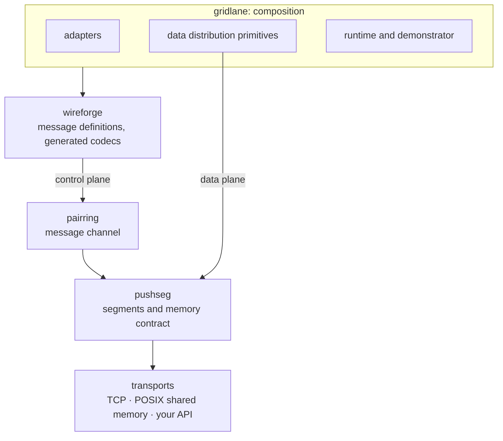
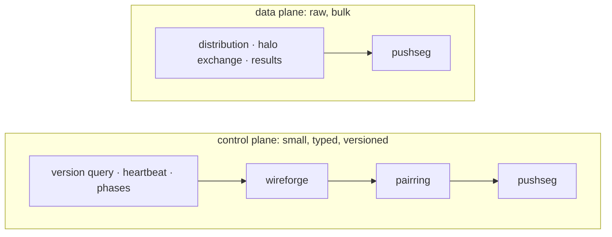
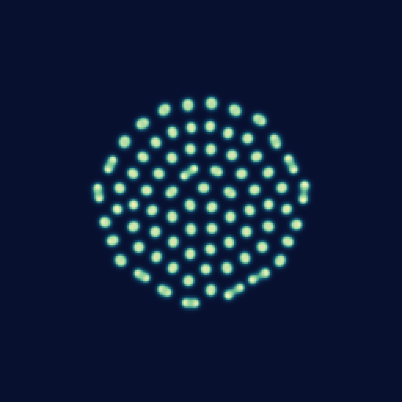

# gridlane

**A layered, loosely coupled model for data distribution and messaging with
low latency, between processes and across machines.**

gridlane is a design, not a product. Its layers are separate projects, each
defined by a contract, each extensible with new APIs, and joined only through
small adapters in this repository, so any of them can be replaced. The focus is
data distribution for parallel algorithms; the same layers let any two
independent applications communicate.

> **Status: early.** The layers are composed, the runtime works and the
> demonstrator runs end to end over TCP and POSIX shared memory (section
> "What works today"). The design is in
> [`docs/architecture.md`](docs/architecture.md).

## The layers



| Layer | Project | Role | Extend it by | Details |
|---|---|---|---|---|
| Memory | [pushseg](https://github.com/oguzhankynk/pushseg) | Each process reads its own segments and writes into others' | a stream or mapped backend | [memory contract](https://github.com/oguzhankynk/pushseg#memory-contract) |
| Channel | [pairring](https://github.com/oguzhankynk/pairring) | Whole messages, flow control, CRC, reconnect over remote-writable memory | a `RemoteRegion` | [protocol](https://github.com/oguzhankynk/pairring/blob/main/docs/protocol.md) |
| Messages | [wireforge](https://github.com/oguzhankynk/wireforge) | Typed, versioned messages with generated codecs | any serializer | [guide](https://github.com/oguzhankynk/wireforge/blob/master/docs/GUIDE.md) |
| Composition | gridlane | Adapters, primitives, runtime, demonstrator | new primitives and phases | [architecture](docs/architecture.md) |

No layer references another. Only gridlane knows them all.

## Two planes



Bulk data never goes through the message layer: it is written where the
receiver will read it.

## Portability

The same binaries run on N machines over TCP, or on one machine as N processes
over shared memory; only a configuration file changes, and the results are the
same:

| | Deployment A | Deployment B |
|---|---|---|
| Layout | 2 targets × 1 application × 4 workers | 1 target × 2 applications × 4 workers |
| Between applications | TCP | POSIX shared memory |
| Result | agrees with the reference | agrees with the reference; fields equal to A byte for byte |

```bash
scripts/portability_demo.sh --bin build/release/apps
```

## The demonstrator



A Gray-Scott reaction-diffusion simulation with analysis while it runs
([specification](docs/gray-scott.md)). It is a vehicle for the model, not a
goal: it uses both planes in one program.

- **Control plane** (wireforge over pairring over pushseg): the coordinator
  queries every worker application's version, sends the job, sends heartbeats
  throughout, follows progress and phases, collects a summary per worker and
  ends the run.
- **Data plane** (pushseg, raw): initial fields scattered to the simulation
  group, halo exchange every step, sums by allreduce, snapshots moved M × N to
  the analysis group, histograms combined in a tree of pairs, the final fields
  gathered; barriers between phases.

A Python (numpy) implementation of the same specification is the reference;
the results are compared with a tolerance (`python/compare.py`). The image is
the V field of a 256 × 256 run, 8000 steps, 12 workers in 2 applications over
shared memory (`python/render.py`).

```bash
cmake --preset release && cmake --build --preset release
# 2 targets (simulated by processes) x 1 application x 4 workers, over TCP:
scripts/run_local.sh --bin build/release/apps --layout 0:0:4,1:0:4 \
    --sim 6 --analysis 2 --link tcp --out /tmp/gs --compare
```

`--layout` lists `target:application:workers` entries; `--sim` and
`--analysis` split the workers into the two groups. `--link shm` runs the same
layout over POSIX shared memory.

<br clear="right">

## What works today

- The three layers build together, fetched at pinned revisions.
- **Data plane composition:** a pairring channel runs over pushseg through the
  region adapter (`include/gridlane/glue/pushseg_region.hpp`), tested over TCP
  and POSIX shared memory. Moving 2000 messages takes about 100 ms over TCP and
  about 3 ms over shared memory on one machine, with the same code.
- **Control plane:** the messages between coordinator and workers are defined
  in a wireforge model ([`model/project.yaml`](model/project.yaml)); the codecs
  generated from it ([`generated/`](generated/), committed, one library per
  unit) run over pairring and pushseg through the transport adapter
  (`include/gridlane/glue/pairring_transport.hpp`). Version query, heartbeats,
  job parameters (range-checked by the model) and shutdown are tested over both
  transports. The model's interface control document is
  [`generated/system/system_icd.md`](generated/system/system_icd.md).

- **Data plane runtime:** a layout of targets × applications × threads
  numbers the workers (`include/gridlane/layout.hpp`); each application's
  fabric gives its workers symmetric buffers, put / signal / wait
  (`include/gridlane/fabric.hpp`), and groups with barrier, broadcast, scatter,
  gather and allreduce (`include/gridlane/collective.hpp`). Whether a target
  rank is a thread of the same application or of another one is invisible to
  the worker. Tested over TCP and POSIX shared memory; the same eight workers
  give the same result as 2 targets × 1 application × 4 threads over TCP and
  as 1 target × 2 applications × 4 threads over shared memory.
- **Demonstrator:** the Gray-Scott pipeline above, as a coordinator and worker
  applications (`apps/gray_scott/`), tested end to end against the Python
  reference: an uneven layout over TCP and the portability demo run in CTest.

## Building

```bash
cmake --preset debug && cmake --build --preset debug && ctest --preset debug
```

The layers are fetched with CMake `FetchContent` at pinned revisions. To work
on a layer at the same time, point CMake at your checkout:

```bash
cmake --preset debug -DFETCHCONTENT_SOURCE_DIR_PUSHSEG=../pushseg \
                     -DFETCHCONTENT_SOURCE_DIR_PAIRRING=../pairring
```

Requirements: Linux, a C++17 compiler (GCC 11+ / Clang 14+), CMake 3.25+.
The comparisons with the reference need Python 3 with numpy; without it those
tests are skipped.
Regenerating the control plane code after changing the model needs
`pip install wireforge==0.5.0` and `scripts/regenerate.sh` (see
[`model/README.md`](model/README.md)); building does not need Python.

## License

MIT, see `LICENSE`.
