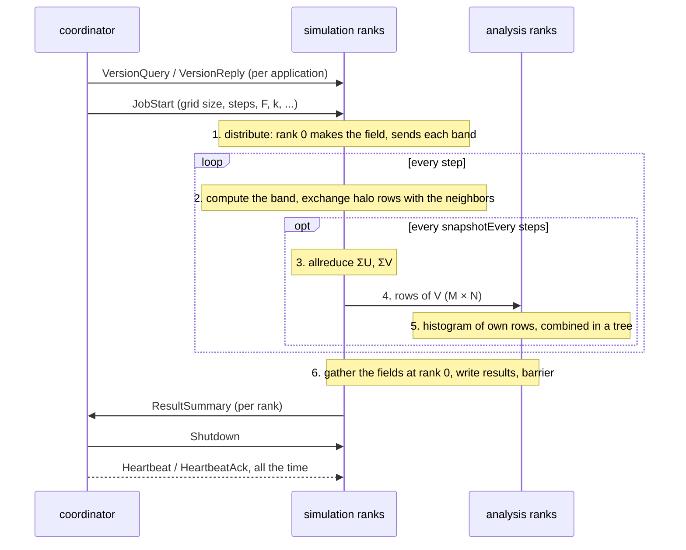

# The Gray-Scott demonstrator: how it works

This directory holds a complete distributed program built on gridlane. This
page explains what it computes, how the work is split across workers, and how
the workers exchange data and messages. The precise numerical specification is
in [`docs/gray-scott.md`](../../docs/gray-scott.md); the design behind it is in
[`docs/architecture.md`](../../docs/architecture.md).

## 1. What is computed

Gray-Scott is a reaction-diffusion model: two chemicals, `U` and `V`, spread
over a surface (diffusion) and react with each other (`U + 2V → 3V`). `U` is
fed in at rate `F`; `V` is removed at rate `F + k`. From an almost uniform
start, spots and stripes appear over time, like the image in the top-level
README.

The surface is a grid of `width × height` cells. It wraps around: the row
above row 0 is the last row, and likewise for columns. Each cell holds two
numbers, `U` and `V`.

**One time step** computes a new value for every cell from the old values of
the cell and of its four neighbors:

```
              north
                ↓
     west  →  cell  ←  east        lap = north + south + west + east − 4·cell
                ↑                  U' = U + dt·(Du·lapU − U·V² + F·(1 − U))
              south                V' = V + dt·(Dv·lapV + U·V² − (F + k)·V)
```

Every new value depends only on the previous step. All the cells of one step
can therefore be computed in any order, by any number of workers, as long as
each worker can see its cells' neighbors from the previous step.

While the simulation runs, the program also **measures** it. Every
`snapshotEvery` steps, and after the last step, it records:

- the sums `ΣU` and `ΣV` over the whole grid;
- a histogram of `V`: how many cells fall in each of 64 value ranges.

At the end, the program writes the final `U` and `V` fields and these
measures to files. A Python implementation of the same specification
(`python/gray_scott_ref.py`) computes the same results independently, and
`python/compare.py` checks that the two agree within a tolerance.

## 2. Who runs what

```
 coordinator application                worker applications (one per layout entry)
 ┌──────────────────────┐               ┌──────────────────────────────────────┐
 │ version query        │  control      │ main thread: control loop            │
 │ job start            │◄────────────► │   answers queries and heartbeats,    │
 │ heartbeats, progress │  plane        │   forwards progress and results      │
 │ results, shutdown    │  (messages)   │ worker threads: one per rank         │
 └──────────────────────┘               │   run the pipeline                   │
                                        └──────────────┬───────────────────────┘
                                                       │ data plane (raw memory)
                                                       ▼
                                        other worker applications' threads
```

- **Coordinator** (`coordinator_main.cpp`): one process. It does not compute
  anything. It starts the job, watches it, and ends it.
- **Worker application** (`worker_main.cpp`): one process per entry of the
  layout. Its main thread talks to the coordinator. Its worker threads do the
  computation.
- **Rank**: a worker thread with a global number. Ranks are numbered across
  all applications.

The **layout** says how many applications there are, where they run, and how
many threads each one has. Each entry is `target:application:threads`:

```
--layout 0:0:4,1:0:4        target 0, app 0: ranks 0 1 2 3
                            target 1, app 0: ranks 4 5 6 7
```

A worker thread only knows its rank and the total number of ranks. Whether
rank 5 is a thread of its own process, a process on the same machine, or a
process on another machine is the fabric's concern (`include/gridlane/fabric.hpp`).
The algorithm code is the same in every case.

## 3. Splitting the work

The ranks are split into two groups by `--sim S --analysis A` (`S + A` must be
the number of ranks):

- ranks `0 … S−1` form the **simulation group**: they compute the steps;
- ranks `S … S+A−1` form the **analysis group**: they compute the histograms
  while the simulation continues.

For `--sim 6 --analysis 2` with the layout above, ranks 0 to 5 simulate and
ranks 6 and 7 analyse.

### Row bands

Each group splits the grid into horizontal bands of rows: member `i` of `n`
gets rows `[⌊i·H/n⌋, ⌊(i+1)·H/n⌋)`. The bands differ by at most one row, so
uneven sizes work too. For a grid 12 rows high, 3 simulation ranks and 2
analysis ranks:

```
 row   simulation group      analysis group
  0  ┐                     ┐
  1  │ rank 0              │
  2  │                     │
  3  ┘                     │ rank 3 (analysis member 0)
  4  ┐                     │
  5  │ rank 1              ┘
  6  │                     ┐
  7  ┘                     │
  8  ┐                     │ rank 4 (analysis member 1)
  9  │ rank 2              │
 10  │                     │
 11  ┘                     ┘
```

The bands of the two groups do not line up. This is deliberate: it is the
case where moving data between groups requires a real M × N redistribution
(section 4, phase 4).

## 4. The phases

Every rank runs `Pipeline::run` (`pipeline.cpp`). A simulation rank runs
phases 1 to 4. An analysis rank runs phase 5. Phase 4 and phase 5 overlap in
time. Then every rank takes part in phase 6.



### Phase 1: distribute

Rank 0 builds the whole initial field. It is uniform, with a square in the
middle and noise added. The noise of each cell comes from the cell's index
only, so any implementation, split in any way, starts from the same field.
Rank 0 then writes each simulation rank's band directly into that rank's
memory, and signals it. The other ranks wait for the signal. This is a
scatter.

### Phase 2: simulate, with halo exchange

To compute its first and last rows, a rank needs one row from the band above
and one from the band below: its **halo**. Each rank therefore keeps its band
with one extra row on each side:

```
             ┌──────────────────────────┐
  row 0      │ north halo               │ ← copy of the last row of the band above
             ├──────────────────────────┤
  rows 1..n  │ own rows (n = band size) │   computed by this rank
             ├──────────────────────────┤
  row n+1    │ south halo               │ ← copy of the first row of the band below
             └──────────────────────────┘
```

Each step, for every simulation rank:

1. Compute the new values of the own rows from the old values and the halos.
2. Write the first new row into the **south halo of the rank above**, and the
   last new row into the **north halo of the rank below** (the bands wrap
   around: the rank above rank 0 is the last rank). Signal each of them:
   "halo for step s is there".
3. Wait until both neighbors have signalled the same for this rank's halos.

A rank only ever writes into another rank's memory and reads its own. This is
pushseg's model: "write far, read local".

Old and new values are kept in two separate buffers, selected by the parity
of the step: step `s` reads buffer `(s−1) mod 2` and writes buffer `s mod 2`.
Two buffers are enough. A neighbor can be at most one step ahead, because it
cannot start step `s+1` before it has received this rank's rows of step `s`.
So a neighbor never overwrites a halo that is still being read.

### Phase 3: global measures

At a snapshot step, each simulation rank sums its own cells. The group then
combines the partial sums with an **allreduce** (`include/gridlane/collective.hpp`).
Every member sends its partial sum to member 0. Member 0 adds them in member
order and sends the total back to all members. Adding in a fixed order gives
the same total on every run.

### Phase 4: in transit transfer (M × N)

The simulation does not stop for the analysis. It hands a copy of `V` to the
analysis group and continues. Each simulation rank sends each analysis rank
the rows their two bands have in common. In the 12-row example:

```
 simulation rank 0  rows 0-3  ──►  analysis member 0
 simulation rank 1  rows 4-5  ──►  analysis member 0
 simulation rank 1  rows 6-7  ──►  analysis member 1
 simulation rank 2  rows 8-11 ──►  analysis member 1
```

An analysis member has one buffer for incoming rows. Before a simulation rank
overwrites that buffer with snapshot `k`, it waits for the member's
acknowledgement that snapshot `k−1` is done. This is flow control: a slow
analysis eventually holds back the simulation, and no data is lost.

### Phase 5: analysis, with a reduction tree

Each analysis member waits until every simulation rank has delivered its rows
of snapshot `k`, then counts its rows into a 64-bin histogram. The partial
histograms are added in a **tree of pairs**:

```
 level 0:   m0 ← m1      m2 ← m3      m4 ← m5      m6 ← m7
 level 1:   m0 ←──────── m2           m4 ←──────── m6
 level 2:   m0 ←───────────────────── m4
```

Member 0 ends up with the total and sends it to simulation rank 0, which keeps
it with the sums of the same snapshot. Every member then acknowledges the
snapshot to the simulation ranks (phase 4).

This phase shows workers that cooperate in pairs, and pairs of pairs, rather
than all at once.

### Phase 6: collect

Every simulation rank writes its final band into rank 0's gather buffer, at
the band's position in the whole grid. Rank 0 waits for all bands and for the
last histogram, then writes `U.bin`, `V.bin` and `result.json`. Finally, every
rank, simulation and analysis, enters a **barrier**. No process may exit while
another one may still be writing into its memory.

## 5. How ranks synchronise: put, signal, wait

Every data exchange above uses three operations of the fabric:

| Operation | Meaning |
|---|---|
| `put(rank, buffer, offset, data, bytes)` | write bytes into another rank's buffer |
| `signal(rank, flag, index, value)` | set a 64-bit flag in another rank's memory, after the preceding puts |
| `wait(flag, index, value)` | wait until one's own flag reaches `value` |

A signal is ordered after the puts before it. So once a rank sees the flag,
the data is there. Flags carry increasing values (the step number, the
snapshot number), so they never need to be reset.

Every application allocates the same buffers in the same order (the
`Pipeline` constructor). As a result, a buffer has the same offset in every
rank's memory, and a rank can name a place in another rank's memory without
asking. This is called **symmetric memory**.

Puts between threads of the same application are plain memory copies. Puts
to another application go through pushseg: over TCP, or over POSIX shared
memory. The pipeline code is the same either way.

## 6. The control plane

Alongside the computation, the coordinator and the main thread of every
worker application exchange typed messages. The messages are defined in
[`model/project.yaml`](../../model/project.yaml) and their codecs are
generated by wireforge into `generated/`:

| Message | Direction | Purpose |
|---|---|---|
| `VersionQuery` / `VersionReply` | coordinator ↔ worker | protocol and software version, number of threads; a mismatch stops the run |
| `JobStart` | coordinator → worker | grid size, steps, model parameters, group sizes (range-checked by the model) |
| `Heartbeat` / `HeartbeatAck` | coordinator ↔ worker | liveness, round-trip time |
| `Progress`, `PhaseDone` | worker → coordinator | step count, phase durations |
| `ResultSummary` | worker → coordinator | per rank: checksum of the final band, sums, timings |
| `Shutdown` | coordinator → worker | end of the run |

Each connection (`control_channel.hpp`) stacks three layers. pushseg provides
an inbox segment on each side. pairring runs a message channel over the two
inboxes. wireforge encodes and decodes messages on top. Worker threads never
send themselves: they hand their reports to the main thread through a queue,
because a pairring channel has a single sending thread.

Bulk data (fields, rows, histograms) never travels as messages. It is written
directly into the memory where the receiver will read it.

## 7. Files

| File | Contents |
|---|---|
| `kernel.hpp/.cpp` | the step, the initial field, sums, histograms; a single-threaded run (the baseline) |
| `pipeline.hpp/.cpp` | phases 1 to 6 on the data plane |
| `control_channel.hpp` | one control connection: pushseg inbox, pairring channel, wireforge link |
| `worker_main.cpp` | worker application: control loop and worker threads |
| `coordinator_main.cpp` | coordinator application |
| `serial_main.cpp` | `gridlane_gray_scott_serial`: the single-threaded run, for comparison |
| `options.hpp` | command line parsing |

## 8. Running it

```bash
cmake --preset release && cmake --build --preset release

# 8 ranks: 2 targets (simulated by processes) × 1 application × 4 threads, over TCP
scripts/run_local.sh --bin build/release/apps --layout 0:0:4,1:0:4 \
    --sim 6 --analysis 2 --link tcp --out /tmp/gs --compare

# the same 8 ranks as 1 target × 2 applications × 4 threads, over shared memory
scripts/run_local.sh --bin build/release/apps --layout 0:0:4,0:1:4 \
    --sim 6 --analysis 2 --link shm --out /tmp/gs-shm --compare

# both of the above, and a byte-for-byte comparison of their fields
scripts/portability_demo.sh --bin build/release/apps

# an image of V
python3 python/render.py --run /tmp/gs --out v.png
```

`run_local.sh` writes the configuration file, starts the coordinator and the
worker applications, and, with `--compare`, checks the results against the
Python reference. Each worker application's log is in `worker-*.log` in the
output directory.

How the results are checked:

- The fields of a distributed run are **bit-identical** to the
  single-threaded run, for every split. Each cell sees the same operations in
  the same order (unit test `GrayScottTest`).
- Against the Python reference they agree **within a tolerance** (relative
  `1e-9`): the specification allows two implementations to differ in the
  last bits.
- Any two deployments of the same job produce **byte-identical** fields
  (`portability_demo.sh`).
